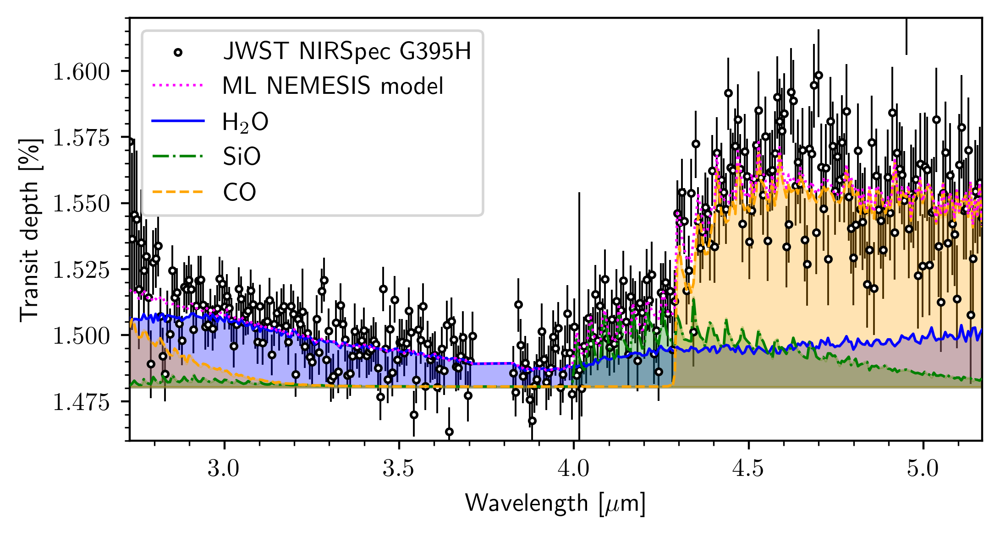
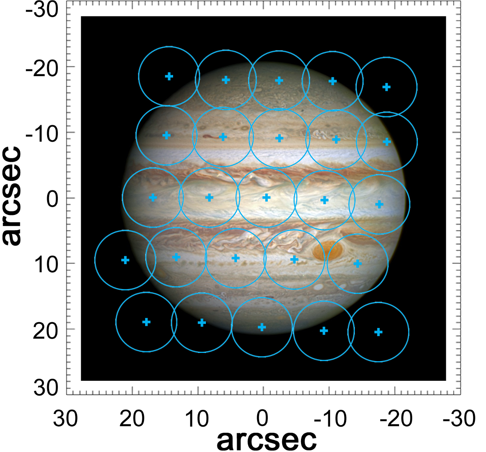
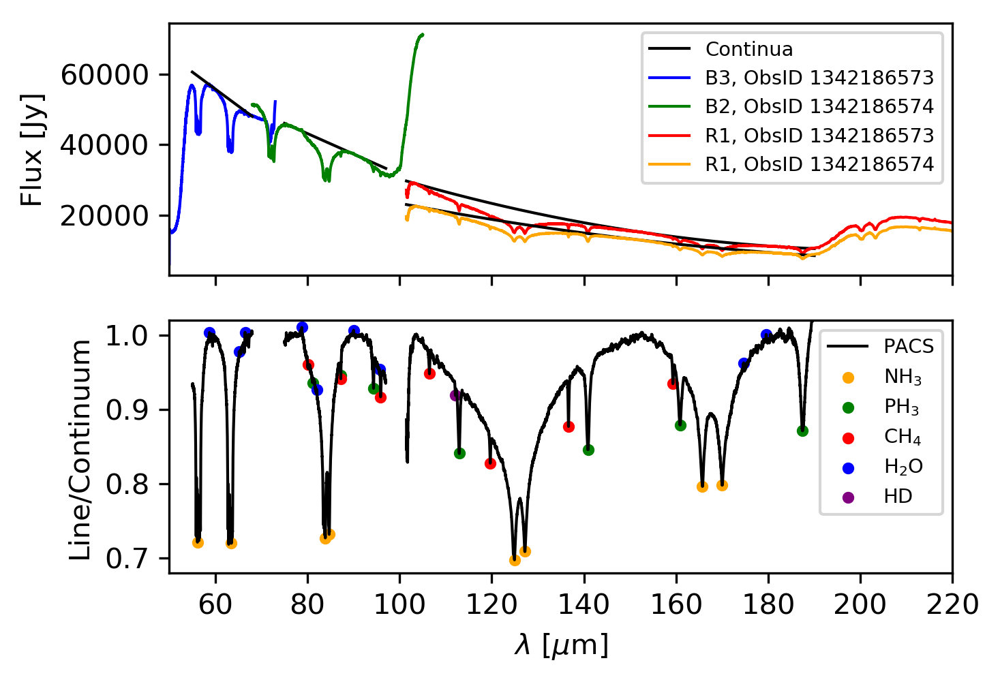

You can find a list of my publications on [SciX](
https://scixplorer.org/search?p=1&q=author%3A%22gapp%2C+cyril%22++year%3A2014-&sort=score+desc&sort=date+desc&d=astrophysics).

The SPACE Program II: No Discernible Spectral Features in the Transmission Spectrum of the Sub-Neptune HD 191939 b Observed with HST/WFC3 ([2026, AJ 172 202](https://doi.org/10.3847/1538-3881/ae9866))
----------------------------------------------------------------------------

The atmospheres of sub-Neptunes provide a window into their internal structure and history, shedding light on the origin of this common, but enigmatic, class of exoplanets. However, the physical and chemical processes that shape sub-Neptunes’ transmission spectra, in particular cloud and haze formation, are not well understood. To identify possible correlations between transmission spectra and UV irradiation, the Sub-Neptune Planetary Atmosphere Characterization Experiment (SPACE) Program observed an array of sub-Neptunes and their host stars using the Hubble Space Telescope (HST), measuring the planets’ transmission spectra between 1.1 and 1.7 μm with the Wide Field Camera 3 (WFC3) and the stars’ UV spectra with the Space Telescope Imaging Spectrograph (STIS). Here, we present the observations of HD 191939 b carried out as part of the SPACE Program, which reveal no significant spectral features in the transmission spectrum. The data deliver moderate evidence at significance levels between 2.0σ and 3.2σ against a cloud-free atmosphere with solar metallicity, rendering this scenario unlikely, but still possible. A supersolar metallicity of HD 191939 b might be consistent with the known trend of increasing atmospheric metallicity with decreasing planet mass. Both hydrocarbon haze formation and cloud condensation can be efficient at HD 191939 b’s zero-albedo equilibrium temperature of (880 ± 20) K, particularly in atmospheres with supersolar metallicity, possibly additionally muting absorption features.

[SciX](https://scixplorer.org/abs/2026AJ....172..202G/abstract)  
[Poster summary (presented at Exoplanets 6)](https://zenodo.org/records/22644481)

Atmospheric asymmetries in WASP-121b revealed by rotational transits detected with JWST ([2026, Nature Astronomy, 10, 1323](https://doi.org/10.1038/s41550-026-02887-6))
----------------------------------------------------------------------------

In this paper, we present a conclusive detection of rotational modulations of WASP-121b’s transmission spectrum in observations with NIRISS and NIRSpec onboard JWST. This finding demonstrates that the transmission spectrum probes different longitudes in the planet’s atmosphere as a function of orbital phase due to the planet’s rotation during transit. The phase-resolved transmission spectrum reveals increased CO, but decreased H2O absorption in the planet towards the end of the transit. This firstly shows that WASP-121b’s temperature structure is asymmetric about the sub-stellar point with higher temperatures in the eastern than in the western half of the dayside. And secondly, H2O depletes out of the atmosphere as hotter parts of the planet are probed while CO remains abundant thanks to its stability against thermal dissociation.

[SciX](https://scixplorer.org/abs/2026NatAs..10.1323G/abstract)  
[MPIA's press release](https://www.mpia.de/news/science/2026-04-wasp-121-b?c=5313826)  
[Talk slides (presented at Exoplanets 6)](https://doi.org/10.5281/zenodo.21218221)

WASP-121b's transmission spectrum observed with JWST/NIRSpec G395H reveals thermal dissociation and SiO in the atmosphere ([2025, AJ 169 341](https://doi.org/10.3847/1538-3881/ad9c6e))
----------------------------------------------------------------------------

WASP-121b is an extrasolar gas giant orbiting an F6-type star in a distance less than two times the star's diameter, making it one of the hottest planets known. Its transmission spectrum observed with JWST/NIRSpec (see below) shows a clear absorption feature of gas-phase silicon monoxide (SiO) between 4.0 and 4.3µm. This molecule has not been detected in any planet's atmosphere before, because in gaseous planets, silicon is expected to be condensed into clouds or locked in the deep interior unless atmospheric temperatures become as high as they are in WASP-121b. With the detection of silicon monoxide, we can aim to quantify the amount of rocky material that was accreted by the planet during its formation and migration to its current orbit as any silicate rocks that hit the planet in the past will have been vaporized into the atmospheric silicon monoxide we see today.  
In addition to silicon monoxide, the transmission spectrum shows a fairly shallow water (H2O) and a massive carbon monoxide (CO) absorption feature. Three-dimensional models suggest that the carbon monoxide feature is not only set by the atmospheric carbon monoxide abundance, but also by the thermal dissociation of molecular hydrogen (H2), the primary constituent of the atmosphere, into atomic hydrogen on the dayside. By reducing the dayside atmosphere's mean molecular weight, H2 dissociation boosts the absorption feature of carbon monoxide. The water feature is not sensitive to this effect, because water, unlike carbon monoxide, dissociates on the dayside, making the water feature sensitive to the nightside's atmospheric conditions only. Thus, the transmission spectrum we see is the composite of atmospheric conditions in WASP-121b's two very distinct hemispheres.

[SciX](https://scixplorer.org/abs/2025AJ....169..341G/abstract)  
[MPIA's press release](https://www.mpia.de/news/science/2025-03-wasp-121b)  
[Poster summary (presented at EAS2025)](/files/eas2025.pdf)

Abundances of trace constituents in Jupiter's atmosphere inferred from Herschel/PACS observations ([2024, A&A, 688, A10](https://www.aanda.org/articles/aa/full_html/2024/08/aa47345-23/aa47345-23.html))
----------------------------------------------------------------------------

We inferred the chemical composition of Jupiter's troposphere, the part of the atmosphere where the visible ocher clouds reside, from FIR spectra observed with PACS onboard the Herschel Space Observatory. The observations show numerous spectral features caused by ammonia, phosphine, methane, water and deuterated hydrogen in Jupiter (see right Figure below). While all of these molecules have been detected in Jupiter in similar quantities before, our analysis of the Herschel observations suggests a faster depletion of phosphine out of the upper troposphere than what has been measured before. In Jupiter, vertical mixing transports phosphine from the deep atmosphere to the upper troposphere, where it quickly gets dissociated by Solar radiation. Our analysis suggests that the PACS observations are especially sensitive to dry parts of Jupiter’s atmosphere that are poor in clouds and thus provide less shelter against photodissociation. Therefore, the faster depletion of phosphine out of the upper troposphere we found might be especially important for these regions of the Jovian atmosphere.  
In addition to presenting new constraints on the detected molecules' abundances in Jupiter, we set the most stringent upper limits to date on the abundances of hydrogen halides in Jupiter's troposphere. It has been suggested that these halides react with ammonia, which is abundant in Jupiter’s troposphere, to solid ammonium salts and our new upper limits support this picture.

  <figure>
    
    <figcaption>Herschel/PACS Jupiter observations</figcaption>
  </figure>

  <figure>
    
    <figcaption>Extracted spectra</figcaption>
  </figure>

[SciX](https://scixplorer.org/abs/2024A%26A...688A..10G/abstract)  
[Poster summary (presented at EPSC2024)](/files/epsc2024.pdf)
